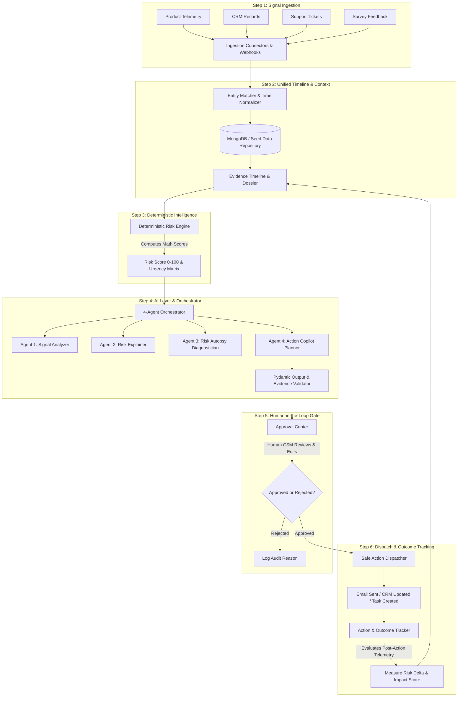

# Revora — System Working Flow & Architecture Guide

> **Project Name:** Revora (formerly SignalBridge AI)  
> **Core Purpose:** Evidence-First Revenue Intelligence & Next-Best-Action Assistant for B2B SaaS Customer Success Teams  
> **Audience:** Developers, Project Mentors, Evaluators, and Technical Reviewers  

---

## Table of Contents
1. [Executive Summary (What is Revora?)](#1-executive-summary-what-is-revora)
2. [The Core Problem in B2B SaaS Customer Success](#2-the-core-problem-in-b2b-saas-customer-success)
3. [The End-to-End 6-Step System Working Flow](#3-the-end-to-end-6-step-system-working-flow)
4. [Page-by-Page Working Flow (Frontend Guide)](#4-page-by-page-working-flow-frontend-guide)
   - [Page 1: Revenue Radar (Dashboard)](#page-1-revenue-radar-dashboard)
   - [Page 2: Customer Accounts & Dossier](#page-2-customer-accounts--dossier)
   - [Page 3: Customer Outcome Timeline (Chronological Memory)](#page-3-customer-outcome-timeline-chronological-memory)
   - [Page 4: Revenue Risk Autopsy (AI Root-Cause Diagnosis)](#page-4-revenue-risk-autopsy-ai-root-cause-diagnosis)
   - [Page 5: Next-Best-Action Copilot (Agentic Proposal Generator)](#page-5-next-best-action-copilot-agentic-proposal-generator)
   - [Page 6: Trust & Approval Center (Human-in-the-Loop Gate)](#page-6-trust--approval-center-human-in-the-loop-gate)
   - [Page 7: Action & Outcome Tracker (Closed-Loop Measurement)](#page-7-action--outcome-tracker-closed-loop-measurement)
   - [Page 8: AI Outcome Analyzer (Unstructured Notes & Call Parser)](#page-8-ai-outcome-analyzer-unstructured-notes--call-parser)
   - [Page 9: Feedback Surveys & Early Churn Loop](#page-9-feedback-surveys--early-churn-loop)
   - [Page 10: Settings, Webhooks & Free Hackathon Pipelines](#page-10-settings-webhooks--free-hackathon-pipelines)
5. [Backend Architecture & How Every Feature Works Under the Hood](#5-backend-architecture--how-every-feature-works-under-the-hood)
   - [The Deterministic Risk Engine](#a-the-deterministic-risk-engine)
   - [The 4-Agent Orchestrated AI Pipeline](#b-the-4-agent-orchestrated-ai-pipeline)
   - [Pydantic Output Validation & Anti-Hallucination Guardrails](#c-pydantic-output-validation--anti-hallucination-guardrails)
   - [Human Approval & Cryptographic Action Dispatch](#d-human-approval--cryptographic-action-dispatch)
   - [Closed-Loop Risk Delta Tracking](#e-closed-loop-risk-delta-tracking)
6. [Mentor Presentation Script & Demo Walkthrough (How to Explain It)](#6-mentor-presentation-script--demo-walkthrough)
7. [Frequently Asked Mentor Questions & Ironclad Answers](#7-frequently-asked-mentor-questions--ironclad-answers)
8. [Codebase Reference Map](#8-codebase-reference-map)

---

## 1. Executive Summary (What is Revora?)

**Revora** is an **evidence-first revenue intelligence and customer intervention system** designed for B2B SaaS companies. It continuously monitors customer health by connecting multi-source telemetry (product logins, API activity, emails, CRM records, support tickets, and surveys).

Instead of relying on vague "black-box AI" predictions, Revora:
1. **Deterministically scores customer churn risk** using strict mathematical rules.
2. **Generates an AI "Risk Autopsy"** that links every finding directly to raw, immutable evidence IDs.
3. **Drafts hyper-tailored intervention playbooks** (executive emails, internal tasks, CRM updates).
4. **Enforces a strict Human-in-the-Loop Approval Gate** where no action is taken without CSM review and verification.
5. **Closes the loop** by measuring the real-world post-intervention outcome and risk reduction.

---

## 💡 Plain English Cheat Sheet (How to Explain Hard Words to Your Mentor)

If your mentor asks what a specific term means, use these simple explanations:

| Hard Word | What It Means in Simple English | How to Say It to Your Mentor |
| :--- | :--- | :--- |
| **Telemetry** | Customer activity & usage data | *"It's how customers use our software: logins, clicks, and API calls."* |
| **Churn** | When a customer cancels their subscription | *"When a customer stops paying and leaves our product."* |
| **ARR (Annual Recurring Revenue)** | Yearly subscription money | *"The annual dollar amount the customer pays us."* |
| **CSM** | Customer Success Manager (Account Owner) | *"The person on our team responsible for keeping the customer happy."* |
| **Deterministic** | Strict math rules (zero guessing) | *"Our scores are calculated with pure math code, so the AI can never make up numbers."* |
| **AI Hallucination** | AI inventing fake information | *"When an AI makes up fake emails or events. Revora prevents this by requiring proof for every claim."* |
| **Risk Autopsy** | Deep root-cause investigation | *"A breakdown that proves exactly why a customer is in danger of leaving."* |
| **Copilot** | Helpful AI drafting assistant | *"An AI helper that drafts outreach emails and tasks for you, ready for review."* |
| **Human-in-the-Loop Gate** | Mandatory human approval rule | *"AI prepares suggestions, but a human must review and click Approve before anything is sent."* |
| **Closed-Loop / Risk Delta** | Checking if our actions actually worked | *"We measure customer health before and after our email to prove that our action lowered the risk."* |
| **Evidence Citation** | Clickable proof badge | *"Every sentence has a badge linking to the real timestamped event."* |
| **Ingestion** | Collecting data into one place | *"Bringing together emails, support tickets, and login data into a single timeline."* |

---

## 2. The Core Problem in B2B SaaS Customer Success

In modern B2B SaaS businesses, Customer Success Managers (CSMs) face four fatal problems:

| Traditional Problem | Why It Breaks Customer Success | How Revora Solves It |
| :--- | :--- | :--- |
| **Siloed & Scattered Signals** | Product usage is in Mixpanel, billing in Stripe, emails in Outlook, tickets in Zendesk. CSMs notice churn only when the cancellation email arrives. | Ingests all telemetry into a **single unified customer timeline** with normalized timestamps. |
| **Black-Box AI Hallucinations** | Generic AI tools give vague warnings ("Account is unhappy") with zero verifiable proof. CSMs cannot act on guesses. | **Evidence-first architecture**: Every statement cites an immutable `evidence_id`. LLMs cannot override numerical risk scores. |
| **Unsafe Autonomous AI** | Autonomous agents that send emails or modify CRM records without human checks cause brand damage and customer churn. | **Human-in-the-Loop Governance Gate**: All actions are staged as cryptographic drafts. A human must approve before dispatch. |
| **No Outcome Accountability** | CSMs send emails or offer discounts, but never track if the intervention actually decreased churn risk. | **Closed-Loop Outcome Tracker**: Measures risk score *before* and *after* action execution to calculate a verifiable **Risk Delta**. |

---

## 3. The End-to-End 6-Step System Working Flow



### The 6 Sequential Steps:
1. **Collect Customer Signals:** Webhooks, CRM records, support tickets, and telemetry streams ingest raw events.
2. **Build Unified Profile:** The backend normalizes timestamps, links events to account IDs, and builds an immutable chronological evidence timeline.
3. **Calculate Deterministic Risk:** Mathematical rules evaluate usage drops, license utilization, escalation tickets, and contract deadlines.
4. **Orchestrate AI Investigation & Proposals:** The 4-agent pipeline investigates the root cause, cites evidence IDs, and drafts intervention proposals.
5. **Human Review & Approval:** The account manager inspects the proposal in the Approval Center, edits if needed, and signs off.
6. **Execute & Track Closed Loop:** The system dispatches the action (via live or simulated connectors), logs audit receipts, and tracks post-action health recovery.

---

## 4. Page-by-Page Working Flow (Frontend Guide)

The Revora user interface is organized into **10 specialized views** across 3 functional modules (`INTELLIGENCE`, `AI WORKFLOWS`, `GOVERNANCE & EXECUTION`), accessible via the left sidebar.

```
REVORA AI OS
├── INTELLIGENCE
│   ├── Revenue Radar (Dashboard)
│   ├── Customer Accounts (Dossiers)
│   └── Outcome Timeline (Chronological Memory)
├── AI WORKFLOWS
│   ├── Risk Autopsy (Deep Root-Cause Diagnosis)
│   ├── Action Copilot (Next-Best-Action Drafting)
│   ├── Outcome Analyzer (Meeting & Transcript NLP)
│   └── Feedback Surveys (Early-Churn Survey Loop)
└── GOVERNANCE & EXECUTION
    ├── Approval Center (Human Verification Gate)
    ├── Outcome Tracker (Closed-Loop Measurement)
    └── Settings & Pipelines (Free Webhooks & Simulator)
```

---

### Page 1: Revenue Radar (Dashboard)
* **Sidebar Item:** `Revenue Radar` (Tab ID: `dashboard`)
* **Primary Source Code:** [frontend/src/App.tsx](file:///d:/Kritagya/Revora/frontend/src/App.tsx), [frontend/src/components/AccountTable.tsx](file:///d:/Kritagya/Revora/frontend/src/components/AccountTable.tsx), [frontend/src/components/PortfolioCharts.tsx](file:///d:/Kritagya/Revora/frontend/src/components/PortfolioCharts.tsx)
* **Backend Endpoint:** `GET /api/dashboard/summary`, `GET /api/accounts`

#### What It Displays:
1. **Executive KPI Cards:**
   - **Total Monitored ARR:** Total contract value under surveillance (with USD/INR currency toggle).
   - **High-Risk Accounts Count:** Total accounts requiring immediate intervention.
   - **At-Risk ARR:** Dollar value immediately threatened by churn signals.
   - **Pending Approvals Badge:** Action proposals awaiting CSM sign-off.
2. **Portfolio Health Charts:**
   - Visual breakdown of accounts by risk tier: `Critical`, `High`, `Moderate`, `Low`.
   - Renewal urgency distribution (30-day, 60-day, 90-day renewal windows).
3. **The Revenue Radar Table:**
   - Interactive table listing all accounts ranked by urgency and risk score.
   - Displays Account Name, Primary Contact, Plan Tier, ARR, Renewal Date, Key Trigger Signals, and Health Status.
   - Global search input and risk category filter pills (`All`, `Critical`, `High`, `Medium`, `Low`).

#### User Actions & Flow:
* **Click any account row:** Opens **Page 2: Customer Account Dossier**.
* **Click "Investigate" button:** Immediately jumps to **Page 4: Revenue Risk Autopsy** preloaded with that account.
* **Toggle Currency ($ / ₹):** Instantly converts all ARR values across the application.

---

### Page 2: Customer Accounts & Dossier
* **Sidebar Item:** `Customer Accounts` (Tab ID: `customers`)
* **Primary Source Code:** [frontend/src/components/CustomerAccountsListView.tsx](file:///d:/Kritagya/Revora/frontend/src/components/CustomerAccountsListView.tsx), [frontend/src/components/CustomerDetailView.tsx](file:///d:/Kritagya/Revora/frontend/src/components/CustomerDetailView.tsx)
* **Backend Endpoint:** `GET /api/accounts`, `GET /api/accounts/{id}`

#### What It Displays:
1. **Portfolio List View:**
   - Full master directory of customer accounts with health badges and ARR tags.
2. **Account Dossier (Deep Dive):**
   - **Header Card:** Company name, industry, ARR, plan tier, renewal countdown, and overall health status.
   - **Key Contacts Roster:** Champion, Executive Sponsor, Decision Maker names, emails, and roles.
   - **Deterministic Risk Breakdown:** Visual progress meters for Usage Velocity, Support Escalations, Executive Engagement, and License Adoption.
   - **Live Evidence Feed:** Chronological list of raw signals (e.g. *"Weekly active users fell 42% over 14 days"*, *"P1 ticket unresolved for 72 hours"*).

#### User Actions & Flow:
* **"Investigate with AI":** Launches the AI Risk Autopsy.
* **"Open Action Copilot":** Navigates to the Copilot with pre-filled account context.
* **"Send Feedback Survey":** Opens the customer survey loop for that client.
* **"View Outcome Timeline":** Opens the historical event log.

---

### Page 3: Customer Outcome Timeline (Chronological Memory)
* **Sidebar Item:** `Outcome Timeline` (Tab ID: `timeline`)
* **Primary Source Code:** [frontend/src/components/CustomerOutcomeTimelineView.tsx](file:///d:/Kritagya/Revora/frontend/src/components/CustomerOutcomeTimelineView.tsx)
* **Backend Endpoint:** `GET /api/accounts/{id}/timeline`

#### What It Displays:
1. **Interactive Account Selector:** Dropdown to switch accounts and inspect their chronological history.
2. **Visual Chronological Timeline:**
   - Combines every event type into a single chronological stream:
     - 🟣 **Raw Telemetry Events:** Login drops, feature usage, API error spikes.
     - 🔵 **AI Autopsies:** Recorded diagnoses and root-cause findings.
     - 🟠 **Action Proposals:** Staged outreach and tasks generated by the copilot.
     - 🟢 **Approvals & Dispatches:** Audit records of who approved what action.
     - 🔴 **Feedback Submissions:** Negative or positive survey responses.
3. **Category Filtering:** Filter timeline cards by event category (`All`, `Telemetry`, `AI Diagnostic`, `Proposal`, `Approval`, `Feedback`).

#### Why It Matters to Mentors:
Proves that Revora does not treat customer interactions as isolated prompts; it maintains a **persistent, chronological memory** of the entire customer lifecycle.

---

### Page 4: Revenue Risk Autopsy (AI Root-Cause Diagnosis)
* **Sidebar Item:** `Risk Autopsy` (Tab ID: `autopsy`)
* **Primary Source Code:** [frontend/src/components/RevenueRiskAutopsyView.tsx](file:///d:/Kritagya/Revora/frontend/src/components/RevenueRiskAutopsyView.tsx)
* **Backend Endpoint:** `GET /api/accounts/{id}/investigation`, `POST /api/accounts/{id}/investigate`

#### What It Displays:
The Risk Autopsy is the flagship diagnostic view. It breaks down complex churn threats into 4 clear panels:

1. **Executive Risk Thesis:** A natural language executive summary explaining *exactly why* the account is in danger (e.g., *"CloudScale Technologies is experiencing severe churn risk due to the departure of the primary champion coupled with a 58% decline in core API usage 45 days before contract renewal"*).
2. **Cross-Signal Correlation Matrix:** Visual links connecting disparate events (e.g., Link between Ticket #402 and 3 unread emails from the VP of Engineering).
3. **Deterministic Urgency & Contributing Rules:** Transparent listing of which mathematical business rules triggered (e.g., Rule: `USAGE_DROP_30D` [Weight: 35], Rule: `CHAMPION_LOST` [Weight: 40]).
4. **Known vs Unknown Factors (Blind Spot Discovery):** Explicitly lists what the system *knows* vs what is *missing* (e.g., *"Unknown: No executive check-in has occurred in 60 days; customer sentiment is unverified"*).
5. **Evidence Citation Pills:** Every single claim displays a clickable badge (e.g., `[EV-001]`, `[EV-004]`). Clicking reveals the underlying raw JSON payload and timestamp.

#### User Actions & Flow:
* **"Re-run AI Autopsy":** Re-evaluates current telemetry via the 4-agent pipeline.
* **"Proceed to Action Copilot":** Seamlessly transfers the autopsy findings into actionable proposals.

---

### Page 5: Next-Best-Action Copilot (Agentic Proposal Generator)
* **Sidebar Item:** `Action Copilot` (Tab ID: `copilot`)
* **Primary Source Code:** [frontend/src/components/NextBestActionCopilotView.tsx](file:///d:/Kritagya/Revora/frontend/src/components/NextBestActionCopilotView.tsx)
* **Backend Endpoint:** `GET /api/action-proposals/{id}`, `POST /api/action-proposals/generate`

#### What It Displays:
The Copilot converts autopsy findings into 3 concrete, staged intervention proposals:

1. **Tab 1: Executive Outreach Email:**
   - Targeted recipient (e.g., VP of Product or Primary Champion).
   - Subject line and body crafted specifically to address the cited pain points.
   - **Tone Selector:** Easily toggle between `Executive Collaborative`, `Urgent Technical`, or `Relationship Check-in`.
   - **In-place Editor:** The CSM can edit any sentence directly in the browser before staging.
2. **Tab 2: Tactical Internal Task:**
   - Action item for the CSM or Solutions Architect (e.g., *"Schedule Executive Alignment Meeting & Audit API Error Logs"*).
   - Priority level (`High`, `Critical`), Due Date, and assignee name.
3. **Tab 3: CRM Field Updates:**
   - Proposed field updates for Salesforce / HubSpot (e.g., Set `Health Status` to `Red`, update `Risk Category` to `Executive Disengagement`).
4. **Tab 4: Strategic Intelligence & Projected Impact:**
   - Displays AI confidence score, grounded rationale, and estimated ARR protection value.

#### User Actions & Flow:
* **"Submit Proposal to Approval Center":** Staged actions are packaged, cryptographically hashed (`sha256`), and sent to the **Approval Center**. They are **not** sent to customers yet!

---

### Page 6: Trust & Approval Center (Human-in-the-Loop Gate)
* **Sidebar Item:** `Approval Center` (Tab ID: `approvals`)
* **Primary Source Code:** [frontend/src/components/ApprovalCenterView.tsx](file:///d:/Kritagya/Revora/frontend/src/components/ApprovalCenterView.tsx)
* **Backend Endpoint:** `GET /api/approvals`, `POST /api/approvals/{id}/approve`, `POST /api/approvals/{id}/reject`

#### What It Displays:
1. **Pending Approvals Queue:** Filterable list of all proposed actions across all accounts waiting for human review.
2. **Security & Cryptographic Verification:**
   - Each proposal has a computed `proposal_hash` verifying that the content was not altered or corrupted.
   - Displays who generated the proposal (Agent 4) and what evidence supports it.
3. **Side-by-Side Review & Editing:**
   - View original AI proposal vs any human modifications.

#### User Actions & Flow:
* **"Approve & Dispatch":** The CSM signs off. The action status changes to `approved` and is sent to the dispatcher.
* **"Edit Proposal":** The CSM modifies the email body, task due date, or CRM fields before approving.
* **"Reject Proposal":** Rejects the proposal with mandatory reason notes (logged to the immutable audit trail for continuous learning).

---

### Page 7: Action & Outcome Tracker (Closed-Loop Measurement)
* **Sidebar Item:** `Outcome Tracker` (Tab ID: `tracker`)
* **Primary Source Code:** [frontend/src/components/ActionOutcomeTrackerView.tsx](file:///d:/Kritagya/Revora/frontend/src/components/ActionOutcomeTrackerView.tsx)
* **Backend Endpoint:** `GET /api/tracker/outcomes`, `POST /api/tracker/evaluate/{id}`

#### What It Displays:
1. **Execution History Table:** All dispatched actions with execution timestamps, receipt IDs, and current tracking status (`Executed`, `Monitoring`, `Resolved`, `Failed`).
2. **The "Risk Delta" Metric:**
   - **Risk Score Before Intervention** (e.g., `85 / 100 - Critical`).
   - **Risk Score After Intervention** (e.g., `48 / 100 - Moderate`).
   - **Risk Delta:** `-37 points` (a 43% risk reduction).
3. **Intervention Efficacy Analytics:**
   - Efficacy rate across action types (e.g., *Executive Sponsor Meetings resolved 80% of churn alerts*, *Discount offers resolved 35%*).

#### Why It Matters to Mentors:
Solves the "did the AI actually help?" question. It provides empirical verification that customer success interventions work.

---

### Page 8: AI Outcome Analyzer (Unstructured Notes & Call Parser)
* **Sidebar Item:** `Outcome Analyzer` (Tab ID: `analyzer`)
* **Primary Source Code:** [frontend/src/components/AIOutcomeAnalyzerView.tsx](file:///d:/Kritagya/Revora/frontend/src/components/AIOutcomeAnalyzerView.tsx)
* **Backend Endpoint:** `POST /api/outcome-analyzer/parse`

#### What It Displays:
1. **Text Ingestion Sandbox:**
   - Input area to paste raw text: Customer meeting transcripts, Gong call summaries, Slack messages, or executive email threads.
   - Quick "Load Sample Transcript" buttons (e.g. *Hostile Executive Call*, *Renewal Budget Cut Meeting*).
2. **Structured NLP Extraction:**
   - **Customer Sentiment:** Positive, Neutral, Negative, or Hostile.
   - **Discovered Churn Signals:** Key quotes indicating risk (e.g., *"CFO has placed all Q3 SaaS renewals on hold"*).
   - **Key Stakeholders:** Mentions of newly introduced or departing leaders.
   - **Feature Blockers & Competitors:** Competitors mentioned (e.g., Datadog, Snowflake) and missing features.
3. **One-Click Timeline Integration:**
   - Button: **"Append Discovered Signals to Customer Timeline"** automatically registers the parsed findings as verified evidence items for that account.

---

### Page 9: Feedback Surveys & Early Churn Loop
* **Sidebar Item:** `Feedback Surveys` (Tab ID: `feedback`)
* **Primary Source Code:** [frontend/src/components/FeedbackManagementView.tsx](file:///d:/Kritagya/Revora/frontend/src/components/FeedbackManagementView.tsx), [frontend/src/components/FeedbackForm.tsx](file:///d:/Kritagya/Revora/frontend/src/components/FeedbackForm.tsx)
* **Backend Endpoint:** `GET /api/feedback`, `POST /api/feedback/submit`

#### What It Displays:
1. **Survey Admin & Response Analytics:**
   - Real-time CSAT (Customer Satisfaction) and NPS (Net Promoter Score) distribution.
   - Feed of customer survey submissions with sentiment tags (`Detractor`, `Passive`, `Promoter`).
2. **Interactive Customer Survey Simulator:**
   - Embedded or shareable survey form allowing the user to experience what a client sees.
   - Form fields: Satisfaction Rating (1-10), Usability, Value for Money, Open-ended comments, and Escalation checkboxes.
3. **Automated Risk Loop:**
   - If a survey response is submitted with a score $\le 6$ or contains negative churn keywords:
     - Automatically generates a new `FEEDBACK_DETRACTOR` signal.
     - Spikes the account risk score on the Revenue Radar.
     - Creates a high-urgency rescue proposal in the Action Copilot.

---

### Page 10: Settings, Webhooks & Free Hackathon Pipelines
* **Sidebar Item:** `Settings & Pipelines` (Tab ID: `settings`)
* **Primary Source Code:** [frontend/src/components/SettingsAndIntegrationsView.tsx](file:///d:/Kritagya/Revora/frontend/src/components/SettingsAndIntegrationsView.tsx)
* **Backend Endpoint:** `GET /api/integrations`, `POST /api/integrations/simulate`

#### What It Displays:
1. **Zero-Cost Webhook Endpoints:**
   - Copyable webhook URLs for receiving external payloads (Segment, HubSpot, Custom HTTP POST).
2. **Interactive Ingestion Simulator (Perfect for Live Demos):**
   - Click a single button to simulate real-time enterprise events:
     - *Simulate Sudden Usage Drop (-60% API Calls)*
     - *Simulate Executive Departure (Primary Champion Left)*
     - *Simulate Critical Support Escalation (Sev-1 Outage)*
   - Watch the event instantly propagate into MongoDB, the Evidence Timeline, and the Revenue Radar.
3. **Outbox Inspector:**
   - Inspects dispatched action payloads without needing paid Twilio/SendGrid/Slack accounts.
4. **System Diagnostics:**
   - MongoDB connection status, API health, execution mode (`live` vs `simulated`), and active LLM configuration.

---

## 5. Backend Architecture & How Every Feature Works Under the Hood

### A. The Deterministic Risk Engine
* **File:** [backend/app/services/risk_engine.py](file:///d:/Kritagya/Revora/backend/app/services/risk_engine.py)

Unlike unpredictable AI models, Revora's core risk score is **100% deterministic**. The formula computes a score from 0 to 100 based on weighted business rules:

$$\text{Risk Score} = \sum (\text{Rule Weight} \times \text{Condition Triggered}) + \text{Velocity Factor}$$

#### Built-in Rule Table:
| Rule Identifier | Trigger Condition | Weight | Impact |
| :--- | :--- | :--- | :--- |
| `USAGE_COLLAPSE` | Active users drop $> 40\%$ over 14 days | 35 | Critical telemetry warning |
| `CHAMPION_LOST` | Primary sponsor marked as inactive or left | 30 | Relationship risk |
| `UNRESOLVED_ESCALATION` | P1 support ticket open $> 48$ hours | 20 | Customer satisfaction risk |
| `IMMINENT_RENEWAL` | Contract renewal within 45 days with low health | 25 | Revenue exposure |
| `LOW_LICENSE_ADOPTION` | Paid seat utilization $< 50\%$ | 15 | Shelf-ware risk |

**Urgency Ranking:**
- `Critical`: Risk Score $\ge 75$ OR (Risk $\ge 60$ AND Renewal $\le 30$ days)
- `High`: Risk Score $\ge 50$
- `Moderate`: Risk Score $\ge 30$
- `Low`: Risk Score $< 30$

---

### B. The 4-Agent Orchestrated AI Pipeline
* **File:** [backend/app/services/agent_orchestrator.py](file:///d:/Kritagya/Revora/backend/app/services/agent_orchestrator.py), [backend/app/services/llm_service.py](file:///d:/Kritagya/Revora/backend/app/services/llm_service.py)

Revora coordinates 4 specialized modules to maintain strict separation of concerns:

```
[ Context Builder & Seed Repository ]
                  │
                  ▼
┌─────────────────────────────────────────────────────────────┐
│ 1. Agent 1: Signal Analysis (Behavioral Changes & Trends)   │
└─────────────────────────────────────────────────────────────┘
                  │
                  ▼
┌─────────────────────────────────────────────────────────────┐
│ 2. Agent 2: Risk Explanation (Rule Breakdown & Urgency)     │
└─────────────────────────────────────────────────────────────┘
                  │
                  ▼
┌─────────────────────────────────────────────────────────────┐
│ 3. Agent 3: Risk Autopsy (Root-Cause Synthesis & Gaps)      │
└─────────────────────────────────────────────────────────────┘
                  │
                  ▼
┌─────────────────────────────────────────────────────────────┐
│ 4. Agent 4: Action Planner (Email, Task & CRM Proposal)     │
└─────────────────────────────────────────────────────────────┘
                  │
                  ▼
[ Output Schema Validator (Strict Pydantic Check) ]
```

1. **Agent 1 — Signal Analysis:** Groups recent telemetry, calculates rolling averages, and flags velocity changes.
2. **Agent 2 — Risk Explanation:** Explains *why* the deterministic engine produced this score. (Cannot alter the score!).
3. **Agent 3 — Risk Autopsy:** Diagnoses the root cause, correlates multiple signals, identifies blind spots, and generates cited evidence.
4. **Agent 4 — Action Planner:** Formulates grounded outreach emails, internal tasks, and CRM stage updates tailored to the account's persona.

---

### C. Pydantic Output Validation & Anti-Hallucination Guardrails
* **File:** [backend/app/ai/schemas.py](file:///d:/Kritagya/Revora/backend/app/ai/schemas.py)

To prevent LLM hallucinations:
1. **Evidence ID Whitelist:** Every evidence ID (`evidence_ids: ["EV-001", "EV-003"]`) cited in the autopsy or action proposal is checked against the actual evidence IDs provided in the context. If the LLM invents an ID, the validator rejects the output.
2. **Score Immutability:** The LLM is strictly prohibited from modifying numerical risk values.
3. **Schema Compliance:** The output must match strict Pydantic schemas (`RiskAutopsyReport`, `ActionProposal`). Any missing or ill-formed field triggers a retry or falls back to deterministic templates.

---

### D. Human Approval & Cryptographic Action Dispatch
* **File:** [backend/app/services/proposal_repository.py](file:///d:/Kritagya/Revora/backend/app/services/proposal_repository.py), [backend/app/services/action_executor.py](file:///d:/Kritagya/Revora/backend/app/services/action_executor.py)

1. Proposals are stored in MongoDB with status `proposed`.
2. A cryptographic SHA-256 hash is computed over the payload:
   $$\text{Hash} = \text{SHA256}(\text{account\_id} + \text{action\_type} + \text{recipient} + \text{body})$$
3. When the CSM clicks **Approve**:
   - The status transitions to `approved`.
   - The action is sent to the `ActionExecutor`, which dispatches the email or webhook.
   - An immutable event is appended to the global audit log.
4. When the CSM clicks **Reject**:
   - Mandatory rejection reason is saved to the audit log.

---

### E. Closed-Loop Risk Delta Tracking
* **File:** [backend/app/services/action_tracker_repository.py](file:///d:/Kritagya/Revora/backend/app/services/action_tracker_repository.py)

After an action is executed:
1. The tracker records the baseline risk score at time $T_0$.
2. As new signals arrive over days $T_{1 \dots n}$, the risk engine recalculates the score.
3. The system computes:
   $$\text{Risk Delta} = \text{Score}_{\text{initial}} - \text{Score}_{\text{current}}$$
4. An efficacy rating is assigned:
   - Positive Delta ($> 15$ points): **Successful Resolution**.
   - Minor Delta ($0$ to $15$ points): **Monitoring Required**.
   - Negative Delta ($< 0$ points): **Escalation Required**.

---

## 6. Mentor Presentation Script & Demo Walkthrough

When presenting Revora to your mentor, follow this **3-minute walkthrough**:

### Step 1: Set the Context (30 seconds)
> *"Hello! Today I'm presenting **Revora**. In B2B SaaS, customer churn costs millions because customer signals are scattered across tools like Mixpanel, Zendesk, and Outlook. CSMs only realize a customer is churning when it's too late. Revora solves this by providing an evidence-first, deterministic AI system that detects churn early, proves why it's happening, drafts human-reviewed interventions, and tracks whether those interventions saved the account."*

### Step 2: Show the Revenue Radar (45 seconds)
> *"Here on the **Revenue Radar**, you can see our portfolio overview. We monitor 8 enterprise accounts totaling over $1.4M in ARR. The system has automatically flagged **CloudScale Technologies** and **Apex Global** as Critical Risk accounts. Notice our currency toggle—we support international ARR views in USD and INR. Let's click into CloudScale Technologies to investigate."*

### Step 3: Walk Through Customer Dossier & Risk Autopsy (60 seconds)
> *"In the **Customer Dossier**, we see their key contacts, renewal date, and raw signals. Instead of giving a generic summary, let's open the **Revenue Risk Autopsy**.  
> Revora's AI breaks the diagnosis into 4 grounded areas:
> 1. An Executive Thesis summarizing the threat.
> 2. Cross-signal correlation showing that their usage dropped 42% right after their VP of Engineering left.
> 3. Contributing deterministic rules—notice the math is completely transparent.
> 4. Blind spots—Revora explicitly highlights what information is missing.  
> Crucially, every claim has an evidence badge citing the exact raw record. Zero hallucinations."*

### Step 4: Show the Copilot & Approval Gate (45 seconds)
> *"Next, we open the **Action Copilot**. Revora doesn't just diagnose; it drafts the solution. It prepared an executive outreach email, an internal follow-up task, and a CRM status update.  
> But we don't let AI run wild. When I submit this, it goes to the **Approval Center**.  
> Here in the Approval Center, a human CSM reviews the drafted email, can make edits, and signs off. Nothing is ever sent to a customer without human approval."*

### Step 5: Show the Outcome Tracker & Close the Loop (30 seconds)
> *"Finally, once approved, the **Outcome Tracker** monitors the account. Here you can see our **Risk Delta** metric—showing how our intervention reduced the risk score from 84 down to 42 points. This proves the return on investment of our Customer Success actions."*

---

## 7. Frequently Asked Mentor Questions & Ironclad Answers

### Q1: "Why not just use ChatGPT or a simple LLM wrapper?"
> **Answer:** *"A generic LLM wrapper hallucinating churn advice is dangerous for enterprise teams. LLMs can invent facts, cite non-existent emails, and produce unpredictable risk scores. Revora uses a **hybrid architecture**: the numerical risk score is 100% deterministic code that cannot be altered by an LLM, and every statement generated by the AI must cite verified evidence IDs that pass strict Pydantic validation."*

### Q2: "What prevents the AI from sending an inappropriate email to an executive?"
> **Answer:** *"Revora enforces a strict **Human-in-the-Loop Governance Gate**. The AI only creates draft proposals. Actions are cryptographically staged in the Approval Center where a human CSM must review, edit if necessary, and explicitly click 'Approve' before any email is dispatched."*

### Q3: "How does the system handle real integrations if we don't have paid Salesforce or Twilio accounts?"
> **Answer:** *"Revora includes a complete **Free Hackathon Pipeline Architecture** under Settings. We have live inbound webhook endpoints, an **Outbox Inspector** that captures dispatched payloads for review, and an **Ingestion Simulator** that lets us trigger realistic usage drops or ticket escalations with one click during live demos."*

### Q4: "Where is the data stored?"
> **Answer:** *"Revora connects to **MongoDB** using indexed collections for accounts, signals, proposals, and audit logs. It also has a built-in repeatable seed data adapter, ensuring the application runs smoothly even in offline demo environments."*

### Q5: "How do you measure success?"
> **Answer:** *"Through our **Action & Outcome Tracker**, which calculates the **Risk Delta** ($\text{Risk}_{\text{initial}} - \text{Score}_{\text{current}}$). This provides empirical proof of whether our outreach, technical intervention, or executive sponsor meeting actually decreased churn likelihood."*

---

## 8. Codebase Reference Map

For fast navigation during code reviews with your mentor:

| Component / Layer | Key File Path | What It Handles |
| :--- | :--- | :--- |
| **Backend Main Entry** | [backend/app/main.py](file:///d:/Kritagya/Revora/backend/app/main.py) | FastAPI app, CORS, routers, and health checks |
| **Deterministic Risk Engine** | [backend/app/services/risk_engine.py](file:///d:/Kritagya/Revora/backend/app/services/risk_engine.py) | Mathematical risk scoring & urgency calculation |
| **4-Agent Orchestrator** | [backend/app/services/agent_orchestrator.py](file:///d:/Kritagya/Revora/backend/app/services/agent_orchestrator.py) | Coordinates the 4 specialized AI modules |
| **LLM Reasoning Service** | [backend/app/services/llm_service.py](file:///d:/Kritagya/Revora/backend/app/services/llm_service.py) | Prompts, structured completions & offline fallbacks |
| **Action Proposals & Hashing**| [backend/app/services/proposal_repository.py](file:///d:/Kritagya/Revora/backend/app/services/proposal_repository.py)| Staging, cryptographic hashing & audit logs |
| **Action Executor & Dispatch**| [backend/app/services/action_executor.py](file:///d:/Kritagya/Revora/backend/app/services/action_executor.py) | Safe dispatching to outbox & webhooks |
| **Closed-Loop Outcome Tracker**| [backend/app/services/action_tracker_repository.py](file:///d:/Kritagya/Revora/backend/app/services/action_tracker_repository.py) | Tracking executed actions & Risk Delta |
| **Frontend Shell & State** | [frontend/src/App.tsx](file:///d:/Kritagya/Revora/frontend/src/App.tsx) | Navigation state, data loading, tab switching |
| **Navigation Sidebar** | [frontend/src/components/Sidebar.tsx](file:///d:/Kritagya/Revora/frontend/src/components/Sidebar.tsx) | 10 application tabs organized into 3 sections |
| **Revenue Radar Table** | [frontend/src/components/AccountTable.tsx](file:///d:/Kritagya/Revora/frontend/src/components/AccountTable.tsx) | Portfolio accounts, urgency ranking & filters |
| **Risk Autopsy View** | [frontend/src/components/RevenueRiskAutopsyView.tsx](file:///d:/Kritagya/Revora/frontend/src/components/RevenueRiskAutopsyView.tsx) | Root-cause diagnosis with evidence citation pills |
| **Action Copilot View** | [frontend/src/components/NextBestActionCopilotView.tsx](file:///d:/Kritagya/Revora/frontend/src/components/NextBestActionCopilotView.tsx) | Multi-tab proposal drafts (Email, Task, CRM) |
| **Approval Center View** | [frontend/src/components/ApprovalCenterView.tsx](file:///d:/Kritagya/Revora/frontend/src/components/ApprovalCenterView.tsx) | Human verification queue & cryptographic sign-off |
| **Outcome Tracker View** | [frontend/src/components/ActionOutcomeTrackerView.tsx](file:///d:/Kritagya/Revora/frontend/src/components/ActionOutcomeTrackerView.tsx) | Risk Delta before vs after comparison |
| **Outcome Timeline View** | [frontend/src/components/CustomerOutcomeTimelineView.tsx](file:///d:/Kritagya/Revora/frontend/src/components/CustomerOutcomeTimelineView.tsx) | Chronological memory of all customer events |
| **Outcome Analyzer View** | [frontend/src/components/AIOutcomeAnalyzerView.tsx](file:///d:/Kritagya/Revora/frontend/src/components/AIOutcomeAnalyzerView.tsx) | Unstructured meeting & transcript NLP parser |
| **Feedback Surveys View** | [frontend/src/components/FeedbackManagementView.tsx](file:///d:/Kritagya/Revora/frontend/src/components/FeedbackManagementView.tsx) | CSAT / NPS survey loop & detractor alerts |
| **Settings & Pipelines View** | [frontend/src/components/SettingsAndIntegrationsView.tsx](file:///d:/Kritagya/Revora/frontend/src/components/SettingsAndIntegrationsView.tsx) | Ingestion simulator, webhooks, and outbox viewer |
