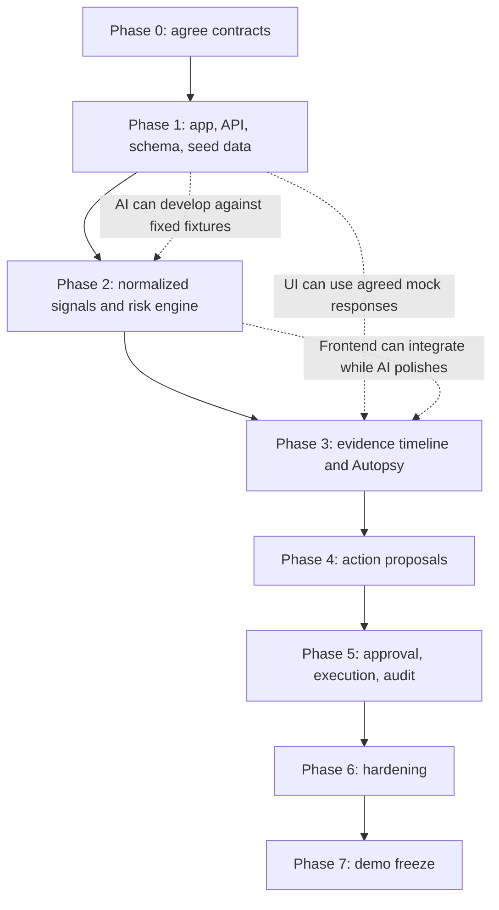

# PHASES_BREAKDOWN.md — SignalBridge AI

> **Purpose:** Give the four-person team a build order, phase-by-phase tasks, ownership, dependencies, and completion gates for the SignalBridge AI MVP.
>
> **Project constraint:** Target a working 36-hour hackathon MVP. Prioritize one complete, reliable evidence-to-action workflow over many partially built features.
>
> **Source of truth:** `PRD.md` defines product requirements. `systemflow.md` defines end-to-end behavior. `tech stack.md` defines the recommended technologies and technical flow. If this plan conflicts with those documents, resolve the conflict explicitly rather than silently changing scope.
>
> **Planning note:** The hour ranges below are suggested elapsed project windows, not promises. Team members should work in parallel where dependencies permit and re-estimate after each phase gate.

---

## 1. Delivery goal

By the end of the build, a judge should be able to:

1. Open SignalBridge AI and see a Revenue Radar for seeded demo accounts.
2. Select an account and inspect its Unified Evidence Timeline.
3. Read a Revenue Risk Autopsy that separates facts, interpretation, and unknowns, with valid evidence references.
4. Review a suggested email, follow-up task, and/or CRM update.
5. Edit, approve, or reject each proposal independently.
6. See the backend block any unapproved or stale-version action.
7. Execute at least one complete action path through a clearly labeled simulated executor, or a tested live connector if time and access permit.
8. See the persisted action outcome and audit history.
9. Repeat the demo from known seed data without relying on unstable external services.

**Definition of success:** The core workflow works end to end. A beautiful screen without a functioning backend workflow is incomplete; a working backend that cannot be demonstrated clearly is also incomplete.

## 2. Four-person ownership

Use role labels rather than names. Assign one person to each role before starting. A person may help another member after completing their own phase deliverables, but each task must have one directly responsible owner.

| Role | Primary ownership | Owns these deliverables | Must coordinate with |
|---|---|---|---|
| **Member 1 — Frontend** | React UI and user experience | App shell, Revenue Radar, account detail, timeline, Autopsy display, proposal review controls, action/audit status, loading/error/empty states | Backend on API contracts; AI on explanation/proposal fields |
| **Member 2 — Backend** | FastAPI and workflow rules | API routes, data access, request validation, account authorization, proposal lifecycle, approval gate, execution interface, status transitions, audit persistence | Database on schema; AI on request/response models; frontend on API contracts |
| **Member 3 — Database and Integrations** | Supabase schema, seed data, normalized records, source/action adapters | Migrations, accounts and source records, 5–10 synthetic accounts, at least three source categories, repository/query helpers, demo executor or first live connector | Backend on models/queries; AI on evidence shape |
| **Member 4 — AI and Risk Engine** | Deterministic scoring and LLM features | Risk rules/reason codes, evidence-grounded Autopsy, structured LLM output, action drafts, evidence-ID validation tests, prompt safety | Backend on interfaces and validation; database on evidence schema; frontend on displayed fields |

### Shared responsibility

All four members must review the end-to-end demo, test their interfaces, and report blockers. The owner is responsible for delivery, not the only person allowed to contribute.

**Recommended coordination rule:** No one should independently invent API payloads or database fields. Agree on the minimum contracts in Phase 0 and update the relevant documentation when a contract changes.

---

## 3. Phase overview

| Phase | Suggested time window | Main outcome | Exit gate |
|---|---:|---|---|
| 0. Align and contract | Hour 0–2 | Scope, interfaces, repo, ownership, demo plan agreed | Frontend/backend/database/AI contracts written down |
| 1. Foundation and seed data | Hour 2–6 | App boots; database and repeatable demo dataset work | Health endpoint, UI shell, schema, seed loader all run |
| 2. Data and risk pipeline | Hour 6–12 | Accounts, evidence, and deterministic risk results available | API returns seeded accounts with risk factors and source-linked signals |
| 3. Core user experience | Hour 10–18 | Radar, timeline, and Autopsy visible in UI | User can select an account and inspect the explanation and evidence |
| 4. AI and action proposals | Hour 14–22 | Structured explanations and action drafts are persisted | Valid Autopsy and proposals appear for seeded accounts |
| 5. Approval, execution, and audit | Hour 20–28 | Safe end-to-end action lifecycle | Unapproved action is blocked; approved demo action is recorded |
| 6. Integration and hardening | Hour 28–33 | Critical failures and safety paths tested | Main acceptance checklist passes |
| 7. Demo freeze and rehearsal | Hour 33–36 | Stable, repeatable presentation build | Demo can be repeated from reset seed data |

The windows overlap intentionally. For example, the frontend can build against agreed mock responses while the backend is still implementing routes. Do not start dependent integration work until the interface contract is agreed.

---

## 4. Phase 0 — Align and define contracts

**Target window:** Hours 0–2

### Goal
Prevent parallel work from becoming incompatible implementations.

### Tasks by member

**Member 1 — Frontend**
- [ ] Agree on the main screens: Revenue Radar, Account Detail, Approval Center, Action/Audit Status.
- [ ] Sketch a simple navigation and component plan.
- [ ] Define the minimum response fields needed to render the screens.
- [ ] Prepare local mock JSON responses for frontend development.

**Member 2 — Backend**
- [ ] Create the FastAPI app skeleton and `/health` endpoint.
- [ ] Propose API routes and request/response contracts.
- [ ] Define the action lifecycle states and backend enforcement rules.
- [ ] Establish error response conventions.

**Member 3 — Database and Integrations**
- [ ] Confirm the canonical account and source-record concepts.
- [ ] Draft the minimal database entities and foreign-key relationships.
- [ ] Choose a stable seed-data format and reset/reload method.
- [ ] Confirm demo mode is the fallback if live integration access is uncertain.

**Member 4 — AI and Risk Engine**
- [ ] Define risk-engine inputs and output fields.
- [ ] Define the structured Autopsy response: facts, interpretations, unknowns, evidence IDs, recommended action.
- [ ] Define action proposal output fields.
- [ ] Agree on a small set of transparent initial risk factors; record weights/thresholds as explicit configuration.

### Shared deliverables
- [ ] Repository created and all four members can run it.
- [ ] One agreed internal account ID and evidence ID convention.
- [ ] Initial API/schema contract written down.
- [ ] Scope frozen to P0 for the first complete path.
- [ ] Live integrations classified as optional until a complete demo path works.

### Exit gate
Do not proceed with independent implementations until the minimum data contract and proposal lifecycle are agreed.

---

## 5. Phase 1 — Foundation and repeatable seed data

**Target window:** Hours 2–6

### Goal
Make the frontend, backend, and database run independently and provide predictable demo data.

**Member 1 — Frontend**
- [ ] Scaffold React + Vite + TypeScript.
- [ ] Configure Tailwind CSS.
- [ ] Build app shell, navigation, page layout, and reusable loading/error/empty states.
- [ ] Connect to the backend health endpoint or show a clear local connection status.
- [ ] Keep mock data isolated so it can be replaced by API calls.

**Member 2 — Backend**
- [ ] Configure FastAPI, Pydantic settings, CORS for local development, and structured logging.
- [ ] Add router structure and a consistent error format.
- [ ] Add initial account-list endpoint backed by a repository or temporary seed adapter.
- [ ] Configure environment loading without committing secrets.
- [ ] Add basic tests for app startup and health endpoint.

**Member 3 — Database and Integrations**
- [ ] Create Supabase project/schema or the agreed test database.
- [ ] Add initial migrations for accounts, external mappings, source records, and risk assessments.
- [ ] Create 5–10 synthetic demo accounts.
- [ ] Include at least three source categories across the dataset, such as CRM, email/calendar, and product usage.
- [ ] Add a repeatable seed/reset script.
- [ ] Preserve source IDs, timestamps, and source type in every relevant record.

**Member 4 — AI and Risk Engine**
- [ ] Implement pure Python input/output models for risk analysis.
- [ ] Define initial reason codes such as `renewal_approaching`, `usage_declining`, and `no_next_step_recorded` only when corresponding inputs exist.
- [ ] Add unit-test fixtures for normal, missing, stale, and conflicting data.
- [ ] Create a deterministic fallback explanation template for use if the LLM is unavailable.

### Exit gate
The UI starts, FastAPI responds, the database is reachable, and the same seed command produces the same known demo accounts. Do not depend on a live provider yet.

---

## 6. Phase 2 — Data normalization and deterministic risk pipeline

**Target window:** Hours 6–12

### Goal
Make account records and risk factors trustworthy before adding AI-generated explanations.

**Member 1 — Frontend**
- [ ] Build the Revenue Radar list/table using mock or real API response shapes.
- [ ] Show risk level/score, urgency, renewal timing when known, and data freshness/coverage.
- [ ] Add account selection and a basic account detail route/panel.
- [ ] Show a clear empty or incomplete-data state.

**Member 2 — Backend**
- [ ] Implement account and source-record repository methods.
- [ ] Add account-list and account-detail/timeline endpoints.
- [ ] Validate account-scoped queries.
- [ ] Add service orchestration for loading signals and requesting risk calculations.
- [ ] Ensure the backend, not the client, owns the authoritative score.

**Member 3 — Database and Integrations**
- [ ] Finalize required columns, indexes, and foreign keys for the current vertical slice.
- [ ] Implement normalized seed loading and duplicate-safe upserts.
- [ ] Validate source records link to canonical account IDs.
- [ ] Add data freshness and data-quality fields or a consistent derived representation.
- [ ] Test missing renewal date, missing usage baseline, duplicate source record, and ambiguous mapping cases.

**Member 4 — AI and Risk Engine**
- [ ] Implement deterministic risk and urgency calculations.
- [ ] Return rule version, contributing factors, reason codes, score/level, and missing inputs.
- [ ] Ensure fixed inputs and the same rule version always produce the same result.
- [ ] Ensure missing or stale data is not silently treated as a negative customer signal.
- [ ] Add tests for each rule and for combinations of signals.

### Exit gate
The backend can return a seeded account with repeatable risk results and source-linked signals. The score must be explainable without using the LLM.

---

## 7. Phase 3 — Evidence timeline and Revenue Risk Autopsy interface

**Target window:** Hours 10–18

### Goal
Make the risk reasoning inspectable and useful to a CSM.

**Member 1 — Frontend**
- [ ] Complete the Unified Evidence Timeline with source, timestamp, short factual summary, and source link when available.
- [ ] Build the Revenue Risk Autopsy panel with separate Fact, Interpretation, Unknowns, and Recommended Next Step sections.
- [ ] Link displayed claims to evidence IDs/source records where the API supports it.
- [ ] Add clear indicators for stale, missing, or conflicting information.
- [ ] Ensure the UI never presents demo records as live data.

**Member 2 — Backend**
- [ ] Implement evidence retrieval scoped to one account.
- [ ] Add or finalize the Autopsy endpoint/response contract.
- [ ] Persist risk assessment and explanation metadata.
- [ ] Reject evidence IDs that do not exist or belong to another account.
- [ ] Return useful source coverage and freshness metadata.

**Member 3 — Database and Integrations**
- [ ] Ensure source records retain provider/source identifiers, timestamps, account link, and normalized facts.
- [ ] Add source-record lookups for evidence references.
- [ ] Check timeline ordering and duplicate handling.
- [ ] Add synthetic scenario records that demonstrate several risk factors without inventing unsupported fields.

**Member 4 — AI and Risk Engine**
- [ ] Implement the LLM service wrapper and structured Autopsy schema.
- [ ] Supply only validated account context and selected evidence to the model.
- [ ] Require the model to separate facts, interpretations, and unknowns.
- [ ] Validate every returned evidence ID against the supplied/authorized evidence set.
- [ ] Add bounded retry or a safe deterministic fallback for malformed/model-unavailable responses.
- [ ] Test that non-response or declining usage is not described as certain churn.

### Exit gate
A user can select an account, see the timeline, and read a factually grounded Autopsy whose evidence references resolve correctly. If LLM access fails, the app remains understandable and does not fabricate success.

---

## 8. Phase 4 — Next-Best-Action proposals

**Target window:** Hours 14–22

### Goal
Turn reasoning into reviewable actions without executing them automatically.

**Member 1 — Frontend**
- [ ] Build action proposal cards for email, follow-up task, CRM update, and/or notification as supported.
- [ ] Show rationale, supporting evidence, target, and editable fields.
- [ ] Add separate edit, approve, and reject controls for each proposal.
- [ ] Show proposal version and current status.
- [ ] Add validation feedback for missing recipient, owner, due date, or target.

**Member 2 — Backend**
- [ ] Implement proposal create/list/get/update endpoints.
- [ ] Store proposals with unique IDs, version numbers, status, and a content hash or equivalent immutable version reference.
- [ ] Validate action types and required fields server-side.
- [ ] Make edits create a new version and invalidate any previous approval.
- [ ] Ensure proposed actions cannot be executed directly from an AI response.

**Member 3 — Database and Integrations**
- [ ] Add action proposal, approval decision, action attempt, and audit tables or the agreed equivalent.
- [ ] Add constraints and indexes for proposal ID, account ID, version, and status.
- [ ] Test persistence and retrieval of proposal versions.
- [ ] Define the demo executor interface; do not yet claim external actions are live.

**Member 4 — AI and Risk Engine**
- [ ] Generate email drafts and task/CRM suggestions from validated account context.
- [ ] Return structured action proposals rather than free-form instructions.
- [ ] Include supporting evidence IDs and a concise rationale.
- [ ] Do not guess missing recipients, owners, or due dates; leave unset or request user input.
- [ ] Validate proposal schema and evidence links before saving.

### Exit gate
The user can review and edit a saved proposal. Editing creates a new version. No external action occurs merely because the AI produced a draft.

---

## 9. Phase 5 — Approval gate, execution, and audit

**Target window:** Hours 20–28

### Goal
Complete the central trust requirement: only approved actions may execute, and outcomes must be truthful.

**Member 1 — Frontend**
- [ ] Complete approval/rejection interactions and confirmation messaging.
- [ ] Display `proposed`, `approved`, `executing`, `succeeded`, `failed`, and `uncertain` statuses.
- [ ] Show audit history and safe error summaries.
- [ ] Distinguish simulated actions from live provider actions in the UI.
- [ ] Refresh status from backend-persisted state after an action.

**Member 2 — Backend**
- [ ] Implement the approval state machine on the server.
- [ ] Bind approval to the exact proposal version/hash.
- [ ] Re-check user authorization, account scope, proposal state/version, required fields, connector mode, and idempotency immediately before execution.
- [ ] Reject unapproved, rejected, stale-version, or unauthorized actions.
- [ ] Persist execution attempts and final statuses.
- [ ] Prevent the frontend from setting its own approval or success status.

**Member 3 — Database and Integrations**
- [ ] Implement a demo executor that records simulated effects and returns explicit demo-mode results.
- [ ] If a live connector is feasible, select one only after the demo executor and safety gate work.
- [ ] Implement idempotency keys and duplicate-request protection.
- [ ] Store provider operation/reference IDs and safe error metadata.
- [ ] Define reconciliation behavior for `uncertain` outcomes; do not blindly retry them.
- [ ] Verify that audit history persists across page refreshes.

**Member 4 — AI and Risk Engine**
- [ ] Verify the AI service has no direct execution credentials or action-execution path.
- [ ] Add adversarial/edge-case tests for fabricated evidence IDs and instructions embedded in imported customer content.
- [ ] Ensure recommendations are framed as suggestions, not guaranteed outcomes.
- [ ] Help test that action proposals include rationale and evidence references.
- [ ] Test the deterministic fallback when the model is unavailable.

### Exit gate
A rejected or unapproved proposal cannot execute. An approved demo action is recorded with a truthful simulated status. An edit invalidates prior approval. Duplicate requests do not silently duplicate effects.

---

## 10. Phase 6 — Integration, testing, and hardening

**Target window:** Hours 28–33

### Tasks for every member

**Member 1 — Frontend**
- [ ] Test loading, empty, missing-data, stale-data, permission-denied, provider-failure, and uncertain states.
- [ ] Check layout at the actual demo screen size.
- [ ] Remove dead buttons and placeholder interactions.
- [ ] Ensure every visible status matches backend data.

**Member 2 — Backend**
- [ ] Run API tests and verify all account-scoped routes enforce access rules.
- [ ] Test stale proposal versions, approval bypass attempts, and duplicate execution requests.
- [ ] Verify errors do not expose secrets.
- [ ] Confirm database writes are consistent after failures.
- [ ] Check that health/readiness endpoints do not expose private configuration.

**Member 3 — Database and Integrations**
- [ ] Reset and reload seed data; verify the demo remains reproducible.
- [ ] Check foreign keys, source ownership, and audit records.
- [ ] Confirm the demo mode cannot be mistaken for live mode.
- [ ] If a live integration is used, verify it with a test account and document the fallback.
- [ ] Confirm all required credentials are configured only in secure environment settings.

**Member 4 — AI and Risk Engine**
- [ ] Run risk-rule tests and structured-output validation tests.
- [ ] Check every evidence reference in Autopsy and proposals.
- [ ] Test model timeout, malformed output, quota/access failure, and safe fallback.
- [ ] Review prompts for prompt-injection resistance and unnecessary personal-data exposure.
- [ ] Check that no claim of churn certainty or measured revenue savings is unsupported.

### Shared end-to-end tests
- [ ] Load the demo dataset.
- [ ] Open the Revenue Radar.
- [ ] Open one account and inspect source-linked evidence.
- [ ] Inspect the Autopsy and confirm facts/inferences/unknowns are separate.
- [ ] Create or load a proposal.
- [ ] Attempt execution without approval and confirm it is blocked.
- [ ] Approve the exact proposal version and execute it in demo mode.
- [ ] Refresh the page and verify action status/audit history persists.
- [ ] Edit an approved proposal and verify old approval is invalidated.
- [ ] Simulate an uncertain result and verify no automatic duplicate retry occurs.

### Exit gate
All critical safety checks pass, and the full user journey works without manual database edits during the demo.

---

## 11. Phase 7 — Demo freeze and rehearsal

**Target window:** Hours 33–36

### Member-specific responsibilities

**Member 1 — Frontend**
- [ ] Polish visual hierarchy and account-risk explanation readability.
- [ ] Ensure the happy path is easy to follow in under the allotted demo time.
- [ ] Verify the UI has no broken routes, console errors, or dead controls.

**Member 2 — Backend**
- [ ] Freeze API contracts and avoid risky refactors.
- [ ] Verify backend startup, health, database connectivity, and error behavior.
- [ ] Confirm approval and execution gates are still enforced in the final build.

**Member 3 — Database and Integrations**
- [ ] Prepare a one-command or documented seed reset.
- [ ] Verify demo account data and source links.
- [ ] Confirm the action executor's demo/live mode is obvious and reliable.

**Member 4 — AI and Risk Engine**
- [ ] Select a known scenario with visible evidence for every major risk factor.
- [ ] Pre-test model availability and fallback behavior.
- [ ] Prepare a concise explanation of how the score is computed and how evidence supports the Autopsy.

**All members**
- [ ] Run the presentation at least twice from a clean state.
- [ ] Assign one presenter and one person responsible for resetting/recovering the demo.
- [ ] Prepare screenshots or a short recorded fallback only if permitted by the event.
- [ ] Freeze feature work; fix only critical defects.
- [ ] Keep a short list of known limitations and describe them honestly.

### Exit gate
The same demo scenario works twice consecutively from a clean state. Do not add a new feature after this gate unless it fixes a critical defect.

---

## 12. Critical path and parallel work

Some work can run in parallel; some has hard dependencies.

### Rules for parallel work
- Frontend can use mock responses, but those mocks must match the agreed API contract.
- AI can develop with fixtures, but its final output must be validated by the backend against persisted evidence.
- Database/integrations should provide stable sample records early, not wait until the UI is complete.
- Backend owns the final integration of scoring, AI output, approvals, and execution.
- Merge small changes frequently. Avoid multiple people editing the same files without coordination.

---

## 13. P0 versus later scope

### P0 — Required before demo freeze
- [ ] Seed data from at least three source categories.
- [ ] Canonical account mapping and source provenance.
- [ ] Deterministic risk score/level and urgency factors.
- [ ] Revenue Radar.
- [ ] Unified Evidence Timeline.
- [ ] Revenue Risk Autopsy with facts, interpretations, and unknowns.
- [ ] AI-drafted next-best actions.
- [ ] Proposal versioning and independent human review.
- [ ] Backend approval gate.
- [ ] At least one end-to-end demo execution path.
- [ ] Execution status and audit history.
- [ ] Reproducible seed/reset and safe fallback.

### P1 — Only after every P0 gate passes
- Counterfactual scenario such as “What if the champion is on leave?”
- Expansion-opportunity scenario.
- One tested live integration if it improves the demo and does not threaten stability.
- Additional UI polish and richer filters.

### P2 — Out of scope for the 36-hour MVP
- Multiple autonomous agents.
- Predictive ML trained on historical churn outcomes.
- Several live integrations built in parallel.
- Vector database or semantic search infrastructure without a demonstrated need.
- Complex multi-tenant enterprise permissions and extensive admin tooling.
- Claims of measured churn reduction or revenue saved without a valid evaluation.

---

## 14. Team coordination and handoff protocol

### Daily/phase check-in
At the end of each phase, each member reports:
1. What is done and where it lives.
2. What can be demonstrated or tested.
3. What is blocked and who can unblock it.
4. Any contract/schema/API change.
5. The next smallest deliverable.

### Definition of “done”
A task is not done because code was written. It is done when:
- It runs in the shared repository.
- It matches the agreed contract.
- It has been tested at the appropriate level.
- Errors and missing-data behavior are handled.
- The next owner can use it without guessing.
- Documentation or setup notes are updated when needed.

### Change control
- Do not rename shared fields or API routes without notifying the other owners.
- If a field or status changes, update the schema/API contract and all consumers.
- Keep provider secrets out of commits, chat messages, screenshots, and frontend bundles.
- Do not remove approval, evidence validation, or audit behavior to save time.
- If behind schedule, cut P1/P2 scope before cutting core safety or the end-to-end workflow.

---

## 15. Final release checklist

- [ ] All four members know their primary ownership and current phase.
- [ ] Project starts from documented instructions.
- [ ] Seed/reset process works.
- [ ] Revenue Radar and account detail work.
- [ ] Evidence references resolve to the correct account.
- [ ] Risk scoring is deterministic and explainable.
- [ ] AI output is schema-validated and evidence-validated.
- [ ] Proposal edits create new versions.
- [ ] Unapproved actions are blocked server-side.
- [ ] Approved demo/live actions have truthful, verified status.
- [ ] Duplicate and uncertain executions are handled safely.
- [ ] Audit history persists.
- [ ] The full demo has passed twice from a clean state.
- [ ] Known limitations are documented and presented honestly.

**Execution rule:** Finish the smallest complete vertical slice first: one account → validated evidence → risk explanation → one proposed action → explicit approval → verified or clearly simulated result → audit record. Then expand the account set and action variety.

---

## 10. Integration Workstream: Mock-First, One Live Connector

This workstream is part of the existing phase plan, not an additional requirement to integrate every named platform. The mock workflow remains the fallback for the final demo.

### Phase 0–1: Decide and define the boundary
- **Backend:** Agree on a provider-neutral adapter contract and typed normalized signal/action models with the database and AI owners.
- **Database:** Ensure source records preserve provider, source record ID, account mapping, timestamps, freshness, and simulated/live provenance.
- **AI:** Consume normalized evidence only; do not call external tools directly or receive connector credentials.
- **Frontend:** Plan visible connection mode/status and `SIMULATED` versus `LIVE` indicators.
- **Exit gate:** The team has agreed on the adapter contract and can run without provider credentials.

### Phase 2–3: Build and test the mock provider
- Implement seeded reads for the required CRM, email, calendar, and usage signals.
- Implement simulated action results through the same application-facing contract intended for live providers.
- Ensure simulated sends/updates cannot be mistaken for real external effects.
- **Exit gate:** The full vertical slice passes repeatedly with the network disabled or external credentials absent.

### Phase 4: Add one live connector only if the core slice passes
- Verify which provider and operations are actually available before coding against them.
- Choose one CRM, HubSpot or Salesforce, for the first read path; do not attempt both by default.
- Choose Composio, a suitable MCP server, or a direct API based on setup time, supported operations, security, and testability.
- Keep the connector behind the backend adapter. Do not put provider SDK logic in the frontend, risk engine, or LLM prompt.
- Add one narrow live action only if its authorization, approval gate, and outcome verification can be tested safely.
- **Exit gate:** Read provenance is validated; write actions are blocked without approval; provider errors and uncertain outcomes are recorded.

### Phase 5–6: Hardening and integration fallback
- Test expired/missing credentials, permission denial, rate limits, timeouts, duplicate requests, wrong-account references, and provider outages.
- Confirm that a live integration failure does not break the seeded demo path.
- Verify that connection status and action results reflect actual state, not optimistic UI assumptions.
- **Exit gate:** Mock fallback is reliable and any live path is demonstrated truthfully.

### Phase 7: Demo freeze
- Prefer the complete mock flow over an unstable live connector.
- If live mode is shown, identify the connected provider and demonstrate only tested operations.
- Never claim an email was sent or CRM updated unless the provider result has been verified.
- Document which integrations are simulated, connected, read-only, or permitted to write.

### Ownership
- **Frontend:** connection/mode indicators and clear action status.
- **Backend:** connector adapter, credentials, validation, approval gate, execution, retries/reconciliation.
- **Database:** source provenance, connection metadata, action attempts, audit outcomes.
- **AI:** evidence-grounded analysis and proposed actions only; no direct provider execution.

### Integration workstream completion checklist
- [ ] Mock provider uses the same normalized contract as live providers.
- [ ] One CRM provider was selected only after checking access and tool support.
- [ ] Composio/MCP/direct API choice is documented with the reason.
- [ ] Secrets remain server-side and use least-privilege permissions.
- [ ] Write operations require approval bound to the current proposal version.
- [ ] Live outcomes are verified; uncertain outcomes are reconciled before retry.
- [ ] Mock and live states are visually and operationally distinct.
