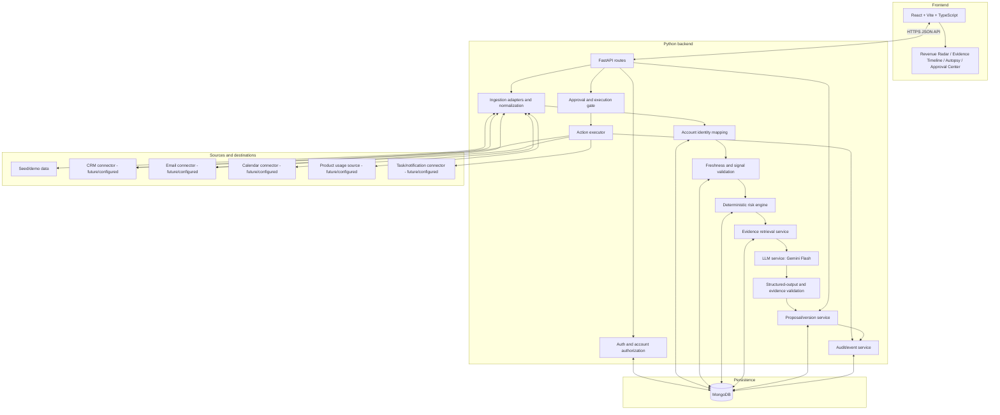
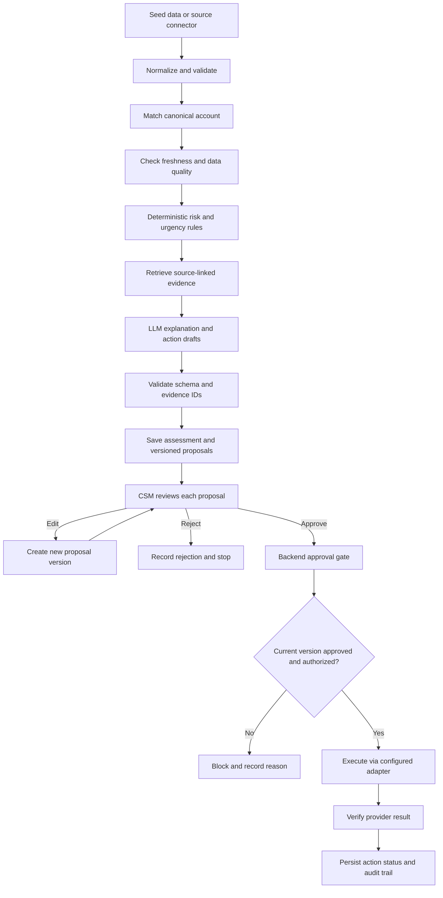

# TECH_STACK.md — SignalBridge AI

> **Purpose:** Define the proposed technologies, component architecture, and technical execution path for the SignalBridge AI hackathon MVP.
>
> **Status:** Recommended implementation baseline, not a claim that every service has already been configured. Confirm API keys, account access, quotas, and current free-tier limits before implementation.
>
> **Decision principle:** Optimize for a reliable end-to-end demo in a 36-hour hackathon. Prefer a small, understandable stack over multiple frameworks or services.
>
> **Related documents:** `PRD.md` is the product source of truth. `systemflow.md` describes end-to-end behavior. `SYSTEM_ARCHITECTURE.md` can expand component/deployment boundaries. `DATABASE_AND_API.md` should define exact schemas and endpoints. `AI_LAYER.md` should define model prompts and validation. `IMPLEMENTATION_PLAN.md` should sequence tasks. `AGENT_RULES.md` should constrain coding-agent behavior.

---

## 1. Technology decisions at a glance

| Layer | Recommended technology | Role | Decision status |
|---|---|---|---|
| Frontend | React + Vite + TypeScript | Single-page web UI for Revenue Radar, timeline, risk autopsy, proposal review, and audit status | Recommended |
| Styling/UI | Tailwind CSS | Responsive layout and consistent styling | Recommended |
| Frontend API access | Native `fetch` or a small typed API client | Communicate with the FastAPI backend | Recommended; avoid adding a large data framework unless needed |
| Backend | Python 3.12+ + FastAPI | API, workflow orchestration, authorization checks, proposal lifecycle, and action execution gates | Recommended; choose a version supported by deployment/runtime |
| Request/data validation | Pydantic | Validate request and response schemas and structured AI output | Recommended |
| Database | MongoDB | Persist accounts, source records, risk assessments, proposals, approvals, attempts, and audit events | Recommended |
| Authentication | Custom session/token auth, only if multi-user login is required for the MVP | User identity and session management | Decision needed based on demo scope |
| Risk scoring | Deterministic Python module | Repeatable, explainable risk and urgency calculations | Required design choice |
| LLM | Gemini Flash model through Google's official Python SDK | Evidence-grounded risk explanations and action drafts | Recommended; verify current model name, SDK, quota, and account access before coding |
| LLM output | Pydantic models / JSON schema validation | Enforce a structured output contract | Recommended |
| Integrations | Provider-specific REST APIs or a chosen integration platform/MCP connector | Read CRM/email/calendar/usage data and execute approved actions | Not finalized; implement seed-data adapters first |
| Background work | Synchronous FastAPI flow for the first vertical slice; add a worker only if demonstrated need exists | Run ingestion/analysis and action workflows | Recommended for MVP |
| Tests | pytest for backend; Vitest/React Testing Library for frontend if time allows | Test rules, permissions, proposal states, and UI behavior | Recommended |
| Version control | Git + GitHub | Collaboration, review, and version history | Recommended |
| Frontend hosting | Vercel or another available static frontend host | Deploy React application | Candidate; verify account/project setup |
| Backend hosting | Render or another Python-compatible host | Deploy FastAPI API | Candidate; verify current free-tier limits and cold-start behavior |
| Secrets/configuration | Environment variables in local `.env` (excluded from Git) and host secret settings | Keep keys and database credentials out of source | Required |
| Observability | Python structured logging plus audit records in MongoDB | Debug requests and inspect workflow/action outcomes | Recommended |
| Vector database | None for MVP | Not needed for structured account signals and source-linked evidence | Explicitly excluded initially |
| Agent orchestration framework | None for MVP | One deterministic workflow plus a bounded LLM call is sufficient | Explicitly excluded initially |

**Do not treat a technology as implemented merely because it appears in this table.** The team must configure it, test connectivity, and record any change from this baseline.

## 2. Why this stack

- **React + Vite:** Fast frontend iteration and straightforward local development.
- **FastAPI + Pydantic:** One Python backend can handle API validation, deterministic scoring, LLM calls, approval gates, and connectors without a second backend language.
- **MongoDB:** Flexible document store suits accounts, evidence references, proposals, and audit history. MongoDB indexes and transactional document operations preserve workflow integrity.
- **Gemini Flash:** A single LLM is sufficient for summarizing evidence and drafting actions. Keep the model behind a small service interface so it can be changed if access, quota, or quality is insufficient.
- **Deterministic Python rules:** Makes scoring reproducible and easier to test than an LLM-owned score.
- **Seed data first:** Keeps the end-to-end workflow demonstrable even if provider credentials or integration approvals are unavailable.
- **No vector DB or multi-agent framework:** The MVP primarily uses structured records and explicit source IDs. Add retrieval infrastructure or agent orchestration only when a tested requirement justifies it.

This is a project-specific recommendation, not a claim that these are the only viable technologies.

## 3. System architecture



### Architectural rules

1. React communicates with the backend through HTTP JSON endpoints. It does not access provider secrets or bypass approval logic.
2. FastAPI is the application boundary and enforces authentication, account scope, input validation, workflow state, and execution policy.
3. MongoDB is the durable record of workflow state. The browser must reload actual persisted statuses rather than infer success locally.
4. The risk engine is deterministic and separate from the LLM service.
5. The LLM receives only the minimum relevant, validated context needed for a specific explanation or draft.
6. The execution gate re-checks authorization and the exact approved proposal version immediately before any consequential operation.
7. External connectors are adapters. Provider-specific payloads should not leak throughout the application.
8. Demo adapters and live adapters must implement the same internal interface but expose clearly different execution modes.
9. Keep the initial workflow synchronous unless ingestion volume or provider latency requires background jobs. Do not add infrastructure solely for theoretical scale.

## 4. Technical flow: from input to outcome

### A. Ingestion and data preparation

1. The ingestion adapter reads seed records or fetches data from a configured source.
2. The adapter converts the payload into the application's normalized internal record model.
3. Pydantic validates types and required fields; malformed records are rejected or quarantined with an error.
4. The identity-mapping service resolves the external account/customer ID to a canonical account ID.
5. The backend persists source provenance, timestamps, normalized values, and data-quality status in MongoDB.
6. The signal service checks freshness, missing fields, and conflicting values before using a record.

### B. Account risk analysis

1. The frontend requests an account list or analysis through FastAPI.
2. The backend loads the account's eligible signals and source coverage.
3. The deterministic risk engine calculates score/level, urgency, contributing factors, and rule version.
4. The evidence service retrieves source-linked facts supporting each relevant factor.
5. The LLM service receives the validated facts, evidence IDs, score factors, and a strict output schema.
6. Pydantic/schema validation checks the LLM output. A separate validator confirms each cited evidence ID exists and belongs to the same account.
7. The backend persists the assessment and explanation metadata; the UI displays the Radar, timeline, and Revenue Risk Autopsy.

### C. Action proposal and approval

1. The LLM drafts candidate email/task/CRM-update/notification content.
2. The backend validates action type, required fields, account, target, and evidence references.
3. Each candidate is stored as a versioned proposal with a stable ID and content hash.
4. The UI shows the rationale and source evidence and lets an authorized user edit, approve, or reject each proposal.
5. Editing creates a new version and invalidates approval for the prior version.
6. Approval is stored server-side and bound to the exact proposal version/hash.

### D. Execution and audit

1. The user initiates execution for an approved proposal, or the backend starts it only after an explicit approved workflow event.
2. The execution gate re-checks user permissions, account scope, proposal status/version/hash, required fields, connector availability, and idempotency.
3. The action executor invokes the configured provider adapter.
4. The backend records the provider response and verifies the result when supported.
5. The action attempt becomes `succeeded`, `failed`, or `uncertain`.
6. The audit service stores the attempt, outcome, timestamps, and relevant references.
7. The UI refreshes from persisted backend state and displays the confirmed outcome.



## 5. Suggested repository layout

Use a simple monorepo unless the team has a strong operational reason to split it.

```text
signalbridge-ai/
├── frontend/
│   ├── src/
│   │   ├── components/       # Reusable UI components
│   │   ├── pages/            # Radar, account detail, approvals
│   │   ├── api/              # Typed backend API client
│   │   ├── types/            # Frontend response types
│   │   └── main.tsx
│   ├── package.json
│   └── vite.config.ts
├── backend/
│   ├── app/
│   │   ├── main.py           # FastAPI app and router setup
│   │   ├── api/              # HTTP routes
│   │   ├── core/             # Settings, auth, permissions
│   │   ├── models/           # Pydantic request/response models
│   │   ├── db/               # Database client and repositories
│   │   ├── ingestion/        # Seed and source adapters
│   │   ├── services/
│   │   │   ├── identity.py
│   │   │   ├── signals.py
│   │   │   ├── risk_engine.py
│   │   │   ├── evidence.py
│   │   │   ├── llm.py
│   │   │   ├── proposals.py
│   │   │   ├── approvals.py
│   │   │   ├── executor.py
│   │   │   └── audit.py
│   │   └── integrations/      # Provider-specific adapters
│   ├── tests/
│   ├── requirements.txt or pyproject.toml
│   └── .env.example
├── mongodb/
│   └── init_mongo.py          # MongoDB index creation & seed database script
├── seed_data/                 # Synthetic demo records only
├── docs/
│   ├── PRD.md
│   ├── systemflow.md
│   └── TECH_STACK.md
├── .gitignore
└── README.md
```

This is a suggested layout, not a requirement to create every module immediately. Start with the modules needed for the first vertical slice; avoid empty abstractions that do not yet have a use.

## 6. Database and persistence

Use MongoDB as the primary durable store. Keep credentials and connection URIs on the server only.

The logical entities should include:
- `accounts`
- `external_account_mappings`
- `signals` or normalized source signal documents
- `risk_assessments`
- `evidence_items` or evidence references
- `action_proposals` with version/hash
- `approval_decisions`
- `action_attempts`
- `audit_events`

The final names and fields are to be specified in `DATABASE_AND_API.md`. Avoid storing the only copy of an approval or action status in frontend state.

Implementation guidance:
- Use collection indexes and initialization scripts to manage document structure and constraints.
- Add indexes for account IDs, timestamps, proposal IDs, and status queries as appropriate.
- Use atomic operations or multi-document transactions when updating proposal state and approval metadata where practical.
- Use an append-oriented audit history for important decisions and action attempts.
- Avoid duplicating large raw source payloads unnecessarily; store minimum needed normalized fields and provider references.
- Use synthetic data for the hackathon unless data handling and provider terms have been reviewed.

## 7. API design principles

Exact endpoint paths and schemas belong in `DATABASE_AND_API.md`. Use consistent resource-oriented endpoints and Pydantic request/response models. Expected API capabilities:

| Capability | Purpose |
|---|---|
| Health/status | Check backend readiness without exposing secrets |
| Accounts and Revenue Radar | Return accounts, risk level/score, urgency, and freshness metadata |
| Account detail/timeline | Return normalized evidence and source references for one account |
| Risk Autopsy | Request or retrieve a validated explanation for an account |
| Action proposals | List, create, and fetch proposal versions |
| Proposal edits | Save a new proposal version and invalidate previous approval |
| Approve/reject | Record an authorized decision against an exact proposal version/hash |
| Execute | Start an approved action after server-side gate checks |
| Action status/audit | Return confirmed status and history for each attempt |

API rules:
- Validate every input and return stable error shapes.
- Enforce account authorization on every account-scoped endpoint.
- Never accept a client-provided `approved=true` as authorization.
- Never expose API keys or raw secrets in error messages.
- Make execution idempotent and record operation IDs.
- Keep long-running provider operations bounded; add background processing only if required.

## 8. LLM integration

Use a small `LLMService` abstraction backed initially by the official Google Gen AI Python SDK and a Gemini Flash model available to the team's account. Verify the current model identifier and SDK API against the official provider documentation during setup; model names and quotas change.

The LLM's permitted responsibilities:
- Explain why validated signals may indicate risk or opportunity.
- Separate facts, interpretations, and unknowns.
- Draft personalized outreach using authorized, relevant context.
- Propose task details or CRM changes for human review.

The LLM must not:
- Own the authoritative risk score.
- Invent source records or evidence IDs.
- Decide the user's permissions or approval status.
- Execute external actions or claim execution succeeded.
- Follow instructions embedded in untrusted email, notes, or customer content that attempt to override application rules.

Recommended call pattern:
1. Construct a minimized, account-scoped context from validated data.
2. Ask for a structured response that matches a Pydantic model.
3. Validate the schema and semantic constraints.
4. Resolve every evidence ID against the database and check account ownership.
5. Reject unsupported output; if retrying, use a bounded retry count.
6. Persist model name, prompt/template version, input references, validation result, and output version as appropriate for reproducibility.

Do not add LangChain, LangGraph, CrewAI, or multi-agent orchestration to the MVP unless a specific demonstrated need outweighs added complexity.

## 9. Integration strategy

### MVP: adapter-first, seed-data-first

Define an internal adapter contract for reading source records and an action adapter contract for approved writes. Begin with synthetic seed data across at least three source categories so the workflow can be completed without external credentials.

### Later: choose the smallest useful live integration

Potential providers mentioned in the problem statement include HubSpot, Salesforce, Linear, Slack, Gmail, Composio, and MCP servers. These are options, not final selections. The team must select based on:
- Access to a test account and API credentials.
- Read/write scope and approval requirements.
- Setup time and reliability during the demo.
- Rate limits, OAuth complexity, and provider terms.
- Whether the integration supports verification and idempotent behavior.

Implement one complete live path before attempting several partial integrations. For example, a live read plus a confirmed action is more valuable than many connectors that are configured but not tested.

### Demo versus live mode

The application must explicitly know whether it is operating in `demo` or `live` mode.

- **Demo mode:** Use synthetic records and simulated action outcomes. UI status must say “Simulated” or equivalent.
- **Live mode:** Require valid server-side credentials, explicit configuration, real authorization checks, human approval, and provider-result verification.
- Never silently fall back from a failed live action to a fake success. If a live operation fails, show failure or uncertainty.

## 10. Security and configuration

Required configuration belongs in environment variables. Commit `.env.example` with names and placeholder values only; never commit actual credentials.

Example variable names (fill values locally; do not place real secrets in this document):

```dotenv
APP_ENV=development
MONGODB_URI=mongodb://localhost:27017
MONGODB_DB_NAME=revora
GOOGLE_API_KEY=
LLM_MODEL=
FRONTEND_ORIGIN=http://localhost:5173
EXECUTION_MODE=demo
```

Not every variable is required for every deployment. Configure MONGODB_URI and credentials on the backend. Never expose database connection strings or Google API key in frontend environment variables.

Security checklist:
- [ ] `.env` is ignored by Git.
- [ ] Secrets exist only in backend/deployment secret configuration.
- [ ] CORS permits only the intended frontend origins.
- [ ] Authentication and account-level authorization are enforced server-side when enabled.
- [ ] Source content is treated as untrusted data, including prompt-injection attempts.
- [ ] Sensitive information sent to the LLM is minimized.
- [ ] Provider actions require backend-verified, version-bound human approval.
- [ ] Audit logs avoid leaking API keys or unnecessary personal data.
- [ ] Demo/live mode is explicit and visible to the operator.

## 11. Testing strategy

Prioritize tests for correctness and safety before visual polish.

### Backend unit tests
- Risk scoring is deterministic for fixed inputs and rule version.
- Missing or stale data is handled without fabricated values.
- Identity matching rejects ambiguous associations.
- LLM evidence IDs must exist and belong to the analyzed account.
- Editing a proposal creates a new version and invalidates prior approval.
- Unapproved, rejected, stale-version, or unauthorized actions are blocked.
- Duplicate execute requests do not duplicate successful external effects.
- `failed` and `uncertain` statuses are not mislabeled as `succeeded`.

### Integration tests
- Database reads/writes work against a test schema or isolated project.
- Seed loading is repeatable.
- API response schemas are stable.
- Demo executor records simulated outcomes.
- Any selected live connector can be tested safely against a test account.

### Frontend tests/manual checks
- Radar and timeline render empty, missing, and stale-data states.
- The user can inspect evidence behind risk claims.
- Each proposal has independent approve/edit/reject controls.
- UI status matches backend-persisted status.
- Demo-mode actions are visibly labeled.
- Loading, permission-denied, provider-failure, and uncertain states are understandable.

## 12. Deployment and local development

### Local development

Run the frontend and backend separately:
- Frontend Vite development server, commonly on port `5173`.
- FastAPI development server, commonly on port `8000`.
- MongoDB-hosted (Atlas or local instance) database.

Exact commands belong in `README.md` after the repository is scaffolded. Do not hardcode production credentials in source code.

### Deployment candidates

- Frontend: Vercel or an available static host.
- Backend: Render or another Python-compatible host.
- Database: MongoDB (MongoDB Atlas or local).

Before selecting a deployment, verify current free-tier policies, sleep/cold-start behavior, environment-variable support, networking, and build/runtime versions. Maintain a reliable local demo fallback in case hosted services are slow or unavailable during judging.

## 13. Build order for the 36-hour MVP

1. **Foundation:** repository, frontend/backend skeleton, environment setup, database schema, and seed data.
2. **Data layer:** normalization, identity mapping, account queries, freshness metadata.
3. **Risk engine:** deterministic scoring, reason codes, tests.
4. **Core UI:** Revenue Radar, account detail, evidence timeline.
5. **AI layer:** structured Autopsy explanation and action drafts; evidence-ID validation.
6. **Approval workflow:** proposal versions, approve/edit/reject, backend state checks.
7. **Execution and audit:** one simulated or live action path, idempotency, result verification, audit UI.
8. **Hardening:** failure states, permission checks, repeatable demo data, test run, deployment/rehearsal.

Do not begin multiple live integrations, vector search, forecasting ML, or multi-agent orchestration until the P0 vertical slice works end to end.

## 14. Acceptance criteria

- [ ] The chosen stack runs locally from documented setup steps.
- [ ] Frontend requests pass through FastAPI rather than directly accessing protected integrations.
- [ ] Seed data from at least three source categories produces an account timeline and risk assessment.
- [ ] The deterministic engine returns a reproducible score/level and reason codes.
- [ ] AI explanations and drafts use validated evidence IDs and distinguish facts from interpretation.
- [ ] Proposals are versioned and persisted.
- [ ] Only an authorized user can approve actions, and approval binds to the exact proposal version/hash.
- [ ] The backend blocks unapproved or stale-version execution.
- [ ] Action execution uses idempotency and records verified `succeeded`, `failed`, or `uncertain` outcomes.
- [ ] Audit history records material decisions and attempts.
- [ ] Demo-mode actions cannot be mistaken for live provider operations.
- [ ] Required tests pass and the full demo is repeatable.

## 15. Unresolved decisions

These items must be decided by the team during implementation:

1. Whether multi-user authentication is required for the hackathon demo or a single-user controlled demo is sufficient.
2. Whether the backend connects to MongoDB Atlas or runs via local MongoDB instance.
3. The exact Gemini Flash model identifier and official SDK version available to the team.
4. The first live integration, if any, and whether its read/write flow can be tested within the hackathon.
5. Exact risk rules, thresholds, usage windows, and baseline definitions.
6. The chosen deployment providers and current service limits.
7. Which API routes and database field names are finalized in `DATABASE_AND_API.md`.
8. Whether action execution runs synchronously or requires a background worker after latency is measured.

Do not silently resolve these decisions in code. Record the chosen option in the implementation documentation and keep this file aligned with the running system.


---

## 16. External Integrations: Composio, MCP, Direct APIs, and Mocks

### 16.1 Recommended strategy

Build a provider-neutral integration adapter in the FastAPI backend. Start with a mock implementation backed by seeded data, then add one real connector only after the complete workflow is reliable. Composio, an MCP server, and a direct provider API are alternative ways to implement an adapter; do not add multiple integration frameworks unless a concrete requirement needs them.

| Option | Use it when | Constraints |
|---|---|---|
| Mock provider | Local development, tests, predictable demo | Must label data and outcomes as simulated |
| Composio | It supports the selected app and required operations with manageable setup | Verify current SDK, supported tools, auth flow, scopes, and quotas |
| MCP server | A suitable server exposes the required tools and can be securely called by the backend | Validate tool schemas/results; treat server output as untrusted |
| Direct provider API | The required operation is clearer or better supported directly | Implement OAuth/token handling, retries, rate limits, and provider-specific errors |

Composio is a candidate, not a locked dependency. MCP is a protocol for tool interoperability, not an alternative to backend authorization or business logic.

### 16.2 Candidate integration order

1. **Mock provider (required):** Seeded CRM, email, calendar, and usage records with stable source IDs.
2. **One CRM read path (conditional on access):** Select HubSpot or Salesforce, not both for the initial MVP.
3. **One narrow live action path (conditional on safe testing):** For example, create a CRM task or send a reviewed email. Use only the operation whose approval and result can be verified.
4. **Optional later sources:** Gmail, Calendar, Slack, or Linear as useful to the workflow and supported by time/access.

Do not assume a platform has the exact tool, permission, or operation we need until verified.

### 16.3 Suggested backend contract

Define a small typed interface, adapted to the project's finalized schemas:

```python
from typing import Protocol, Any

class IntegrationProvider(Protocol):
    async def fetch_account_signals(
        self, account_id: str
    ) -> list[dict[str, Any]]:
        ...

    async def execute_approved_action(
        self, action: dict[str, Any], idempotency_key: str
    ) -> dict[str, Any]:
        ...
```

This is an illustrative interface, not a finalized API contract. Replace generic dictionaries with Pydantic models when the database/API schemas are agreed. Implement `MockIntegrationProvider` first and a provider-specific adapter second. Keep provider SDK objects out of business logic.

### 16.4 Security and reliability requirements

- Only the backend may hold provider secrets or access tokens. Never send them to React, the LLM, logs, or committed files.
- Request least-privilege scopes. Separate read permissions from write permissions where the provider supports it.
- Treat provider records and MCP tool results as untrusted input. Validate structure, source IDs, account mapping, timestamps, and allowed fields.
- The model may recommend an action but must not hold credentials, decide approval, or directly execute writes.
- Enforce approval and proposal-version checks in backend code immediately before execution, regardless of connector.
- Use idempotency keys when supported. If provider support is absent, maintain internal operation IDs and reconcile uncertain outcomes before retrying.
- Apply bounded timeouts and appropriate retry rules. Do not blindly retry non-idempotent writes.
- Record provider, operation type, proposal/version, attempt time, result, and sanitized error details. Never log secrets or unnecessary message content.
- Verify write outcomes before marking them successful. Distinguish `failed` from `uncertain`.
- Keep the demo usable if a provider is down or rate-limited by falling back to mock mode with an explicit label.

### 16.5 Configuration

Use environment variables or the chosen secret manager for credentials and feature flags. Suggested conceptual settings include `INTEGRATION_MODE=mock|live`, `CRM_PROVIDER=hubspot|salesforce|mock`, and provider-specific secret variables. These are proposed names; align them with the repository's configuration conventions before implementation. Fail safely if live mode is selected but credentials or required permissions are missing.

### 16.6 Integration tests

- Mock provider completes the end-to-end flow deterministically.
- Live read calls validate and preserve source provenance.
- Unapproved, rejected, stale-version, wrong-account, and malformed actions are blocked before the provider is called.
- Timeouts, rate limits, permission errors, duplicate requests, and uncertain writes are handled and audited.
- Tests assert that mock outcomes never appear as live successes.
