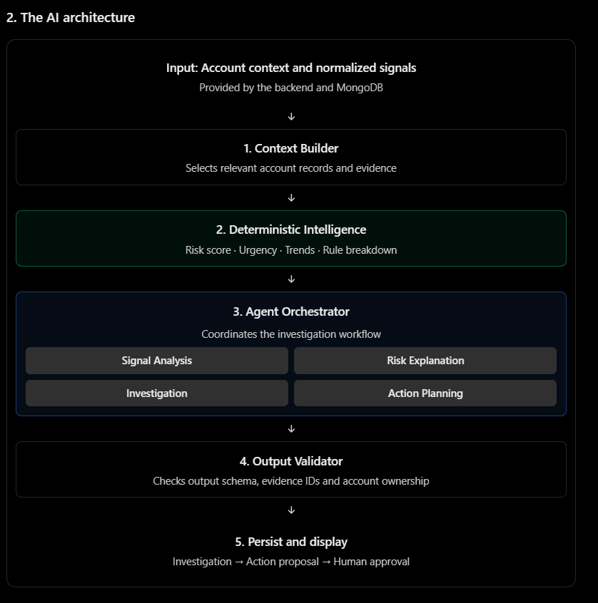

# AI Layer Architecture & Agent Specifications

This document outlines the architecture, pipeline stages, and responsibilities of the 4 specialized agents within the Revora AI Layer.

---

## Architecture Diagram

The AI Layer follows a disciplined 5-stage pipeline coordinated by an orchestrator, combining deterministic calculations with LLM reasoning.



```
Input: Account context and normalized signals
(Provided by backend & MongoDB)
             ↓
[ 1. Context Builder ]
Selects relevant account records and evidence
             ↓
[ 2. Deterministic Intelligence ]
Risk score · Urgency · Trends · Rule breakdown
             ↓
[ 3. Agent Orchestrator ]
Coordinates the investigation workflow
├── Agent 1: Signal Analysis
├── Agent 2: Risk Explanation
├── Agent 3: Investigation
└── Agent 4: Action Planning
             ↓
[ 4. Output Validator ]
Checks output schema, evidence IDs and account ownership
             ↓
[ 5. Persist and Display ]
Investigation → Action proposal → Human approval
```

---

## Pipeline Overview

1. **Input**:
   - Account context and normalized signals provided by the backend and MongoDB.
2. **Context Builder**:
   - Selects relevant account records, timelines, metrics, and evidence.
3. **Deterministic Intelligence**:
   - Computes authoritative numerical scores: Risk score, Urgency, Trends, and Rule breakdown.
4. **Agent Orchestrator**:
   - Coordinates the 4 specialized agent modules across the workflow.
5. **Output Validator**:
   - Verifies output schemas against Pydantic models, strictly checks evidence citation IDs, and validates account ownership.
6. **Persist and Display**:
   - Saves final investigation artifacts and action proposals into MongoDB, rendering them for human review and approval.

---

## The Four Agent Responsibilities

These are four specialized modules coordinated by one orchestrator. They do not all need to be autonomous LLM agents; some are ordinary Python functions combined with LLM explanations where appropriate.

### Agent 1 — Signal Analysis
> **Goal:** Understands changes in customer behavior.

- **Input:** Normalized signals from CRM, email, calendar, product usage, and support.
- **Work:** Group related events, compare recent usage with historical baselines, identify gaps, and summarize relevant changes.
- **Implementation:** Python performs numeric comparisons and time-window calculations. An LLM can help interpret customer messages or summarize related events.
- **Output:** A structured summary of observations, changes, and missing data.

---

### Agent 2 — Risk Assessment (Risk Explanation)
> **Goal:** Explains how serious the warning is.

- **Input:** Verified signals and deterministic rule results.
- **Work:** Explain which rules contributed to the score, identify urgency drivers, and note which data is missing or stale.
- **Implementation:** The score and urgency are calculated in Python. An LLM can explain the results in plain language but **cannot change the authoritative values**.
- **Output:** Risk score, urgency, contributing rules, and limitations.

---

### Agent 3 — Investigation
> **Goal:** Explains why the account was flagged.

- **Input:** Account context, relevant evidence, and risk assessment.
- **Work:** Connect multiple signals into an explanation, separate facts from interpretations, identify conflicting evidence, and suggest what to verify.
- **Implementation:** LLM reasoning over a limited set of supplied records, followed by strict validation.
- **Output:** The **Revenue Risk Autopsy** report.

---

### Agent 4 — Action Planning
> **Goal:** Turns the investigation into a useful next step.

- **Input:** Validated findings, uncertainty, and the CSM's objective.
- **Work:** Choose an appropriate proposed action, draft an email or task, explain why it is recommended, and identify the intended target.
- **Implementation:** LLM-generated structured proposal, checked by backend validation.
- **Output:** An editable proposal awaiting human approval.

---

## Implementation Policy & Constraints
- **Grounding & Evidence IDs:** Any statement produced must reference valid evidence item IDs generated by the Context Builder.
- **Deterministic Supremacy:** LLMs cannot overwrite numerical risk scores or rules computed by deterministic intelligence.
- **Human-in-the-loop:** Proposals generated by Agent 4 are staged in draft form awaiting CSM approval before dispatch.
