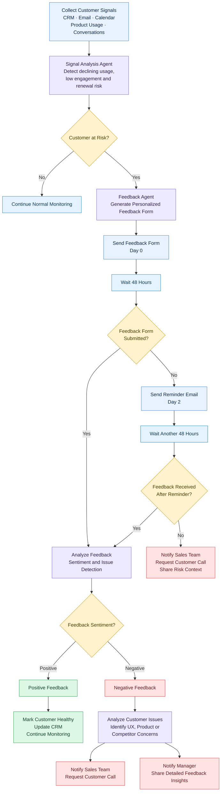

# Feedback Form Flow Specification & Agent Architecture

This document defines the complete end-to-end Feedback Form Flow for **Revora (SignalBridge AI)**.

---

## Detailed Node & Agent Specification

### Phase 1: Ingestion & Signal Detection
* **Node A (Collect Customer Signals)**:
  - **Inputs**: CRM accounts & deals, Gmail/Outlook threads, Google/Exchange calendar meetings, Mixpanel/Segment product telemetry, Zendesk/HubSpot support tickets.
  - **Telemetry Captured**: Weekly license active count, days since last CSM touchpoint, contract renewal milestone date, open bug tickets.
* **Node B (Signal Analysis Agent)**:
  - **Responsibility**: Correlates multi-source evidence to detect early churn trajectories:
    - Usage drop trajectory ($\ge 30\%$ drop in activity)
    - Touchpoint lag ($\ge 25$ days without human interaction)
    - Impending renewal risk ($\le 60$ days to renewal with elevated risk)
    - Open critical bugs or escalations ($\ge 1$ critical blocker)
* **Node C (Customer at Risk? - Decision)**:
  - **Branch No**: Customer health metrics within normal variance $\to$ Routes to **Node D**.
  - **Branch Yes**: At least one churn trigger satisfied $\to$ Routes to **Node E**.
* **Node D (Continue Normal Monitoring)**:
  - Logs regular checkpoint in Revenue Radar; leaves account in standard monitoring pool.

---

### Phase 2: Personalized Feedback Generation & Dispatch
* **Node E (Feedback Agent: Generate Personalized Feedback Form)**:
  - Uses account context and detected telemetry friction to create a targeted, non-generic survey.
  - Generates custom intro addressing champion by name, targeting the specific area of concern (e.g. API integration vs. license adoption).
* **Node F (Send Feedback Form - Day 0)**:
  - Dispatches survey via customer's preferred channel (Email / Webhook / In-App link) with unique survey token.
  - Records timestamp as **Day 0**.
* **Node G (Wait 48 Hours)**:
  - Observation window for customer engagement.
* **Node H (Feedback Form Submitted? - Decision)**:
  - **Branch Yes**: Submission received within 48h $\to$ Routes directly to **Node I**.
  - **Branch No**: No response received after 48h $\to$ Routes to **Node Q**.

---

### Phase 3: Reminder Escalation Loop
* **Node Q (Send Reminder Email - Day 2)**:
  - Dispatches a polite, non-intrusive reminder email reinforcing customer value and priority support.
* **Node R (Wait Another 48 Hours)**:
  - Extended observation window (Day 2 to Day 4).
* **Node S (Feedback Received After Reminder? - Decision)**:
  - **Branch Yes**: Response received following reminder $\to$ Routes to **Node I**.
  - **Branch No**: Account remains unresponsive despite two outreach attempts $\to$ Routes to **Node T**.
* **Node T (Notify Sales Team: Request Customer Call, Share Risk Context)**:
  - Generates high-urgency Sales/CSM call task and webhook notification.
  - Packages unresponsiveness alongside underlying risk indicators (usage drop, renewal date) so sales can intervene via phone.

---

### Phase 4: Feedback Sentiment & Root Cause Analysis
* **Node I (Analyze Feedback: Sentiment and Issue Detection)**:
  - AI analysis parses satisfaction score, user free-text, stated blockers, and improvement requests.
  - Dissects evidence into sentiment classification, urgency level, and explicit uncertainties.
* **Node J (Feedback Sentiment? - Decision)**:
  - **Branch Positive**: Satisfaction score $\ge 7/10$, positive or constructive tone $\to$ Routes to **Node K**.
  - **Branch Negative**: Satisfaction score $\le 6/10$, expressed frustration or critical blocker $\to$ Routes to **Node M**.

---

### Phase 5: Positive Feedback Path
* **Node K (Positive Feedback)**:
  - Acknowledges healthy relationship status.
* **Node L (Mark Customer Healthy, Update CRM, Continue Monitoring)**:
  - Decreases account risk score in database.
  - Updates CRM account status to "Healthy / Low Risk".
  - Registers positive pulse event in Customer Outcome Timeline and returns to normal monitoring.

---

### Phase 6: Negative Feedback Path & Executive Escalations
* **Node M (Negative Feedback)**:
  - Triggers churn prevention response protocol.
* **Node N (Analyze Customer Issues: Identify UX, Product or Competitor Concerns)**:
  - Classifies feedback into 3 critical problem domains:
    1. **UX Friction**: Complex workflows, onboarding roadblocks, difficult user interface.
    2. **Product / Technical Gaps**: Missing features, API limits, system bugs, latency.
    3. **Competitor / Pricing Concerns**: Budget cuts, pricing dissatisfaction, alternative vendor evaluation.
* **Node O (Notify Sales Team: Request Customer Call)**:
  - Creates an actionable Outreach Proposal with pre-drafted talking points tailored to the specific issues identified in Node N.
* **Node P (Notify Manager: Share Detailed Feedback Insights)**:
  - Automatically drafts executive briefing for CS / Sales leadership outlining revenue at risk, customer quotes, and required intervention strategy.
